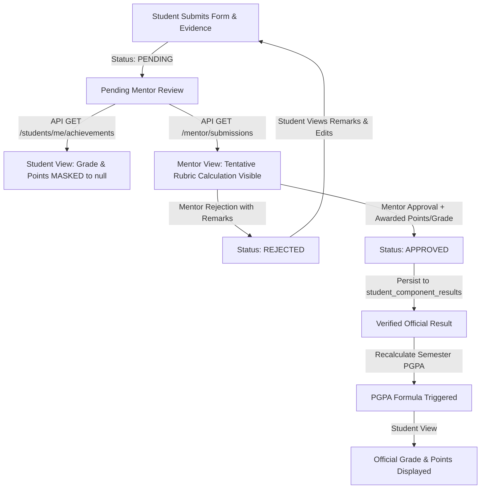

# Comprehensive PGPA Components Audit & Implementation Plan
**Department of Computer and Communication Engineering (CCE)**  
**Sri Sairam Engineering College**  
**Document Reference:** `PGPA_COMPONENTS_AUDIT_AND_PLAN.md`  
**Generated Local Timestamp:** 2026-10-24T23:55:00+05:30  
**Scope:** Read-Only Audit of All 14 PGPA Components, Database Models, Excel Import Logic, Dynamic Form Schemas, Evaluation Rubrics, Role-Based Access Controls, and Result Visibility.

---

## 1. Executive Summary

This audit report documents the current architecture, implementation status, grading rules, and evaluation workflows for all **14 PGPA components** configured within the CCE-PGPA application.

### 1.1 Authoritative Formula and Architecture
The institution evaluates student performance using the **Professional Grade Point Average (PGPA)** formula codified from the 17-page PGPA Evaluation Guidelines:
$$\text{A1} = \frac{\sum (\text{Grade Points Earned} \times \text{Credit Value})}{\sum \text{Credits Attempted}}$$
$$\text{PGPA} = (\text{A1} \times 0.6) + (\text{Semester GPA} \times 0.4)$$

- **A1 Component Weighting (60%):** Derived from co-curricular, extra-curricular, professional certification, and skill assessment achievements across 13 components.
- **Academics/GPA Weighting (40%):** Derived directly from the Anna University semester GPA (0.00 – 10.00 scale) mapped via Table B. It carries `credit_value = 0` in the A1 summation to prevent double-counting.
- **Official Grade Point Scale (Table B):**
  - **O** = 10 Grade Points ($\ge 9.0$)
  - **A+** = 9 Grade Points ($7.0 \le \text{Score} < 9.0$)
  - **A** = 7 Grade Points ($4.0 \le \text{Score} < 7.0$)
  - **B+** = 5 Grade Points ($2.0 \le \text{Score} < 4.0$)
  - **B** = 3 Grade Points ($1.0 \le \text{Score} < 2.0$)
  - **C** = 1 Grade Point ($< 1.0$)

---

## 2. Core Architecture & Workflow Audit

### 2.1 Database Entities and Provenance
The system relies on five primary relational tables in PostgreSQL:

1. **`pgpa_components`** ([`backend/app/models/component.py:16-95`](file:///e:/Projects/pgpa%20web-app/backend/app/models/component.py#L16-L95)):
   - Stores the master catalog of all 14 components.
   - Key attributes: `id` (UUID), `name`, `slug`, `display_order`, `is_active`, `credit_value`, `submission_mode` (`both`, `student_submission`, `direct_staff_entry`), `grading_strategy` (`semester_threshold`, `score_range`, `categorical`, `cumulative_points`, `activity_points_sum`, `internship`), `requires_verification` (boolean), `config_schema` (JSON).

2. **`component_semester_configs`** ([`backend/app/models/component.py:97-154`](file:///e:/Projects/pgpa%20web-app/backend/app/models/component.py#L97-L154)):
   - Configures the 14 × 8 matrix determining which components are enabled for student submissions per semester (Semesters 1 through 8) and their respective deadlines.

3. **`achievements`** ([`backend/app/models/achievement.py:31-127`](file:///e:/Projects/pgpa%20web-app/backend/app/models/achievement.py#L31-L127)):
   - Holds student-submitted activity records.
   - Key fields: `id`, `student_id`, `component_id`, `semester_id`, `title`, `activity_type`, `organizer`, `event_date`, `description`, `outcome`, `component_metadata` (JSON), `status` (`draft`, `pending`, `approved`, `rejected`), `submitted_at`.

4. **`student_component_results`** ([`backend/app/models/grading.py:76-153`](file:///e:/Projects/pgpa%20web-app/backend/app/models/grading.py#L76-L153)):
   - Stores finalized/verified component evaluations per student per semester.
   - Enforces unique constraint: `uq_student_component_semester_result(student_id, component_id, semester_id)`.
   - Fields: `raw_score`, `category`, `grade`, `grade_points`, `credit_value`, `is_verified`, `source` (`hod_import`, `student_submission`), `import_batch_id`, `achievement_id`.

5. **`student_semester_pgpa`** ([`backend/app/models/grading.py:155-208`](file:///e:/Projects/pgpa%20web-app/backend/app/models/grading.py#L155-L208)):
   - Stores the calculated semester PGPA scores.
   - Fields: `a1_score`, `gpa`, `pgpa`, `total_credits_attempted`, `total_credits_earned`, `calculated_at`.

---

### 2.2 Student Submission Flow & Dynamic Forms
- **Frontend Form System:** Implemented in [`frontend/components/student/SubmitAchievementModal.tsx`](file:///e:/Projects/pgpa%20web-app/frontend/components/student/SubmitAchievementModal.tsx) and [`frontend/components/student/EditAchievementModal.tsx`](file:///e:/Projects/pgpa%20web-app/frontend/components/student/EditAchievementModal.tsx).
- **Component-Driven Behavior:** Switching the active component dynamically resets form state and loads component-specific inputs defined in `COMPONENT_DYNAMIC_FIELDS` ([`backend/app/services/component_service.py:43-479`](file:///e:/Projects/pgpa%20web-app/backend/app/services/component_service.py#L43-L479)).
- **Evidence Storage:** Uploaded files (PDFs, certificates, scorecards) are uploaded to student-specific Google Drive folders organized by semester ([`backend/app/services/drive_service.py`](file:///e:/Projects/pgpa%20web-app/backend/app/services/drive_service.py)) and recorded in `achievement_files`.

---

### 2.3 Mentor Approval Flow & Result Visibility Isolation
The application enforces strict data isolation between students and mentors:


- **Masking Mechanism:** Handled server-side in `format_achievement_response()` ([`backend/app/api/v1/endpoints/students.py:108-132`](file:///e:/Projects/pgpa%20web-app/backend/app/api/v1/endpoints/students.py#L108-L132)). If `status != APPROVED` and `is_reviewer == False`, `evaluated_grade`, `evaluated_grade_points`, and `evaluated_points` are forced to `None`.
- **Review History:** Maintained immutably in `verification_logs` ([`backend/app/models/review.py:27-77`](file:///e:/Projects/pgpa%20web-app/backend/app/models/review.py#L27-L77)).

---

### 2.4 HOD Oversight & Excel Batch Import Workflow
- **Template Generation:** [`generate_hod_excel_template()`](file:///e:/Projects/pgpa%20web-app/backend/app/services/component_service.py#L503-L610) creates styled `.xlsx` spreadsheets pre-populated with active CCE department students, register numbers, and component-specific instructions.
- **Two-Phase Commit:**
  1. `POST /api/v1/hod/import/preview`: Parses CSV/Excel, validates register numbers against active student roster, executes `calculate_component_grade()` for tentative grading, checks for duplicates, and caches payload under a secure `preview_token`.
  2. `POST /api/v1/hod/import/confirm`: Atomically commits the batch into `hod_import_batches`, upserts `student_component_results` as verified (`is_verified = True`), and executes `_recalculate_student_semester_pgpa()` for each affected student.

---

## 3. Component-by-Component Detailed Audit

```
┌────────────────────────────────────────────────────────────────────────────────────────┐
│ MASTER 14 PGPA COMPONENTS CATALOGUE                                                   │
├────┬─────────────────────────────┬──────────────────────────────┬────────┬─────────────┤
│ #  │ Slug                        │ Official Name                │ Credit │ Strategy    │
├────┼─────────────────────────────┼──────────────────────────────┼────────┼─────────────┤
│ 1  │ academics-gpa               │ Academics (GPA)              │ 0      │ score_range │
│ 2  │ clubs-and-cells             │ Clubs & Cells                │ 3      │ cumulative  │
│ 3  │ skillrack                   │ Skillrack                    │ 3      │ sem_thresh  │
│ 4  │ amcat                       │ AMCAT                        │ 3      │ score_range │
│ 5  │ internship                  │ Internship                   │ 3      │ internship  │
│ 6  │ sairam-sdg-action-programme │ Sairam SDG Action Programme  │ 3      │ act_points  │
│ 7  │ sairam-innovation-eco-system│ Sairam Innovation Eco-System │ 4      │ categorical │
│ 8  │ sail                        │ SAIL (AI Learning)           │ 3      │ sem_thresh  │
│ 9  │ sports-and-games            │ Sports & Games               │ 3      │ points_sum  │
│ 10 │ online-certifications       │ Online Certifications        │ 2      │ categorical │
│ 11 │ nptel-non-credit-transfer   │ NPTEL (Non-Credit Transfer)  │ 4      │ categorical │
│ 12 │ gate                        │ GATE                         │ 4      │ categorical │
│ 13 │ scouts-for-sdgs             │ Scouts for SDGs              │ 3      │ categorical │
│ 14 │ fit-india-certifications    │ FIT INDIA Certifications     │ 3      │ score_range │
└────┴─────────────────────────────┴──────────────────────────────┴────────┴─────────────┘
```

---

### Component 1: Academics (GPA)
- **Slug:** `academics-gpa`
- **Credit Value:** `0` (Academic GPA is weighted directly at 40% in final PGPA calculation).
- **Grading Strategy:** `score_range` (Table B Anna University 10-point scale).
- **Evidence from Codebase:**
  - Grading: `grade_academics()` in [`backend/app/services/grading_engine.py:384-391`](file:///e:/Projects/pgpa%20web-app/backend/app/services/grading_engine.py#L384-L391).
  - Validation & Uniqueness: [`backend/app/api/v1/endpoints/students.py:441-456`](file:///e:/Projects/pgpa%20web-app/backend/app/api/v1/endpoints/students.py#L441-L456).
  - Form System: [`frontend/components/student/SubmitAchievementModal.tsx:432-466`](file:///e:/Projects/pgpa%20web-app/frontend/components/student/SubmitAchievementModal.tsx#L432-L466).
- **Current Authoritative Grading Rules:**
  - `GPA >= 9.0` $\rightarrow$ **O** (10 GP)
  - `7.0 <= GPA < 9.0` $\rightarrow$ **A+** (9 GP)
  - `4.0 <= GPA < 7.0` $\rightarrow$ **A** (7 GP)
  - `2.0 <= GPA < 4.0` $\rightarrow$ **B+** (5 GP)
  - `1.0 <= GPA < 2.0` $\rightarrow$ **B** (3 GP)
  - `GPA < 1.0` $\rightarrow$ **C** (1 GP)
- **Result Nature:** Semester-wise. Each semester has its own GPA record.
- **Form & Validation:** Only Semester selector and GPA input (`0.00` – `10.00`). Irrelevant fields (Title, Organizer, Level, Dates) are completely omitted. Duplicate submissions for the same semester are strictly rejected by the backend.
- **Required Evidence:** Semester Grade Sheet / Marksheet PDF.
- **Mentor / HOD Flow:** Mentor verifies GPA matches uploaded marksheet. Approving sets `status = APPROVED`, records verified `student_component_results`, and recalculates semester PGPA.
- **Status:** **COMPLETE**. Verified with unit and workflow tests.

---

### Component 2: Clubs & Cells
- **Slug:** `clubs-and-cells`
- **Credit Value:** `3`
- **Grading Strategy:** `cumulative_points` (Table 7.1 point allocations + Table 7.2 semester threshold grading).
- **Evidence from Codebase:**
  - Table 7.1 Point Engine: `calculate_clubs_and_cells_points()` in [`backend/app/services/grading_engine.py:199-242`](file:///e:/Projects/pgpa%20web-app/backend/app/services/grading_engine.py#L199-L242).
  - Semester Grading: `grade_clubs_and_cells()` in [`backend/app/services/grading_engine.py:243-262`](file:///e:/Projects/pgpa%20web-app/backend/app/services/grading_engine.py#L243-L262).
  - Dynamic Form: [`frontend/components/student/SubmitAchievementModal.tsx:470-555`](file:///e:/Projects/pgpa%20web-app/frontend/components/student/SubmitAchievementModal.tsx#L470-L555).
- **Current Authoritative Point Rules (Table 7.1):**
  - **Member:** 100 points.
  - **MAGIC:** 200 points.
  - **Event Coordinator:** 200 points.
  - **Volunteer:** 100 points.
  - **Event Participation:**
    - Within College: 100 points
    - Within State (Other College): 200 points
    - National Level (Other State): 300 points
    - International Level (In College / Others): 400 points
    - International Level (Other Country): 500 points
  - **Winner:**
    - Within College: 200 points
    - Within State (Other College): 300 points
    - National Level (Other State): 500 points
    - International Level (In College / Others): 600 points
    - International Level (Other Country): 700 points
- **Semester Thresholds (Table 7.2):**
  - Evaluated against semester multiplier: S3 ($\ge 300$: O, $\ge 200$: A+, $\ge 100$: A); S4 ($\ge 400$: O, $\ge 300$: A+, $\ge 200$: A); S5 ($\ge 500$: O, $\ge 400$: A+, $\ge 300$: A); S6 ($\ge 600$: O, $\ge 500$: A+, $\ge 400$: A); S7 ($\ge 700$: O, $\ge 600$: A+, $\ge 500$: A).
- **Result Nature:** Cumulative across semester submissions.
- **Form & Validation:** Club selection, Role / Category dropdown, Event Level (conditional for Participation and Winner), Activity Title, Completion Date, and live Table 7.1 point calculation badge.
- **Required Evidence:** Club Membership Proof, Appointment Order, Certificate of Merit, or Certificate of Participation.
- **Mentor / HOD Flow:** Mentor validates category and level before confirming or modifying `awarded_points`.
- **Status:** **COMPLETE**. Table 7.1 and 7.2 point logic is authoritative.

---

### Component 3: Skillrack
- **Slug:** `skillrack`
- **Credit Value:** `3`
- **Grading Strategy:** `semester_threshold` (Table 1.1 thresholds).
- **Evidence from Codebase:**
  - Grading: `grade_skillrack()` in [`backend/app/services/grading_engine.py:43-70`](file:///e:/Projects/pgpa%20web-app/backend/app/services/grading_engine.py#L43-L70).
  - Dynamic Fields: [`backend/app/services/component_service.py:44-62`](file:///e:/Projects/pgpa%20web-app/backend/app/services/component_service.py#L44-L62).
  - HOD Import Parser: [`backend/app/services/component_service.py:840-856`](file:///e:/Projects/pgpa%20web-app/backend/app/services/component_service.py#L840-L856).
- **Current Authoritative Grading Rules (Table 1.1 Cumulative Thresholds):**
  - **Semester 1:** O: $\ge 750$, A+: $\ge 550$, A: $\ge 350$, B+: $\ge 250$, B: $\ge 150$
  - **Semester 2:** O: $\ge 1500$, A+: $\ge 1100$, A: $\ge 700$, B+: $\ge 500$, B: $\ge 300$
  - **Semester 3:** O: $\ge 2250$, A+: $\ge 1650$, A: $\ge 1050$, B+: $\ge 750$, B: $\ge 450$
  - **Semester 4:** O: $\ge 3000$, A+: $\ge 2200$, A: $\ge 1400$, B+: $\ge 1000$, B: $\ge 600$
  - **Semester 5:** O: $\ge 3750$, A+: $\ge 2750$, A: $\ge 1750$, B+: $\ge 1250$, B: $\ge 750$
  - **Semester 6:** O: $\ge 4500$, A+: $\ge 3300$, A: $\ge 2100$, B+: $\ge 1500$, B: $\ge 900$
  - **Semester 7:** O: $\ge 5250$, A+: $\ge 3850$, A: $\ge 2450$, B+: $\ge 1750$, B: $\ge 1050$
  - Fallback/Under-threshold: Grade **C** (1 GP).
- **Result Nature:** Cumulative points evaluated against the specific semester cutoff.
- **Form & Validation:** `points` (positive integer), `milestone_title`.
- **Required Evidence:** Skillrack Profile / Scoreboard screenshot PDF or certificate.
- **Status:** **COMPLETE** for student submission and HOD Excel bulk import. *(Note: Semesters 8+ fallback to Sem 7 thresholds - Pending Institutional Clarification if 8th semester requires distinct thresholds).*

---

### Component 4: AMCAT
- **Slug:** `amcat`
- **Credit Value:** `3`
- **Grading Strategy:** `score_range` (Table 2.1 10-point scale).
- **Evidence from Codebase:**
  - Grading: `grade_amcat()` in [`backend/app/services/grading_engine.py:73-88`](file:///e:/Projects/pgpa%20web-app/backend/app/services/grading_engine.py#L73-L88).
  - Dynamic Fields: [`backend/app/services/component_service.py:63-81`](file:///e:/Projects/pgpa%20web-app/backend/app/services/component_service.py#L63-L81).
- **Current Authoritative Grading Rules (Table 2.1):**
  - `Score >= 9.0` $\rightarrow$ **O** (10 GP)
  - `7.0 <= Score < 9.0` $\rightarrow$ **A+** (9 GP)
  - `4.0 <= Score < 7.0` $\rightarrow$ **A** (7 GP)
  - `2.0 <= Score < 4.0` $\rightarrow$ **B+** (5 GP)
  - `1.0 <= Score < 2.0` $\rightarrow$ **B** (3 GP)
  - `Score < 1.0` $\rightarrow$ **C** (1 GP)
  *(Supports direct 0–10 scaled scores or automatic conversion of percentages if score > 10).*
- **Result Nature:** Semester-wise assessment score.
- **Form & Validation:** `score` (float between 0.0 and 10.0), `assessment_title`.
- **Required Evidence:** Official AMCAT Scorecard / Assessment Report PDF.
- **Status:** **COMPLETE**.

---

### Component 5: Internship
- **Slug:** `internship`
- **Credit Value:** `3`
- **Grading Strategy:** `internship` (Table 3.3).
- **Evidence from Codebase:**
  - Grading: `grade_internship()` in [`backend/app/services/grading_engine.py:91-107`](file:///e:/Projects/pgpa%20web-app/backend/app/services/grading_engine.py#L91-L107).
  - Dynamic Fields: [`backend/app/services/component_service.py:82-121`](file:///e:/Projects/pgpa%20web-app/backend/app/services/component_service.py#L82-L121).
- **Current Authoritative Grading Rules (Table 3.3):**
  - **Core / with stipend:** Minimum **A+** (9 GP); eligible for **O** (10 GP) with outstanding mentor/company rating.
  - **Others (Non-core / unpaid / general industry training):** Capped up to **A** (7 GP).
  - If performance grade is explicitly specified: Evaluated against company classification boundaries.
- **Result Nature:** Semester-wise (typically awarded in Semesters 4, 6, 7, or 8 based on training periods).
- **Form & Validation:** `organizer` (Company Name), `company_type` (`Core / with stipend` vs `Others`), `domain`, `performance_grade` (optional: O, A+, A, B+, B), `duration` (weeks).
- **Required Evidence:** Offer Letter + Completion Certificate + Internship Assessment Form.
- **Status:** **COMPLETE**.

---

### Component 6: Sairam SDG Action Programme
- **Slug:** `sairam-sdg-action-programme`
- **Credit Value:** `3`
- **Grading Strategy:** `activity_points_sum` (Table 4.1 point allocation & Table 4.2 thresholds).
- **Evidence from Codebase:**
  - Grading: `grade_sairam_sap()` in [`backend/app/services/grading_engine.py:110-123`](file:///e:/Projects/pgpa%20web-app/backend/app/services/grading_engine.py#L110-L123).
  - Dynamic Fields: [`backend/app/services/component_service.py:122-155`](file:///e:/Projects/pgpa%20web-app/backend/app/services/component_service.py#L122-L155).
- **Current Authoritative Point & Grading Rules:**
  - **Table 4.1 Point Allocations:**
    - Member: 10 points
    - 1 Activity: 15 points
    - 2 Activities: 30 points
    - 16h Drill: 40 points
    - 25h Drill: 75 points
    - Best Unit / RD Parade: 75 points
  - **Table 4.2 Grading Thresholds:**
    - Points $\ge 75$ $\rightarrow$ **O** (10 GP)
    - $60 \le \text{Points} < 75$ $\rightarrow$ **A+** (9 GP)
    - $45 \le \text{Points} < 60$ $\rightarrow$ **A** (7 GP)
    - $30 \le \text{Points} < 45$ $\rightarrow$ **B+** (5 GP)
    - $11 \le \text{Points} < 30$ $\rightarrow$ **B** (3 GP)
    - Points $< 11$ $\rightarrow$ **C** (1 GP)
- **Result Nature:** Semester-wise activity sum.
- **Form & Validation:** `category` (selection from Table 4.1 actions), `points` (non-negative number), `activity_title`.
- **Required Evidence:** Field Action Report, Attendance Geo-tagged Photo, or Unit Leader Endorsement.
- **Status:** **COMPLETE**.

---

### Component 7: Sairam Innovation Eco-System
- **Slug:** `sairam-innovation-eco-system`
- **Credit Value:** `4`
- **Grading Strategy:** `categorical` (Table 5.1 Innovation Stage Tiers).
- **Evidence from Codebase:**
  - Grading: `grade_innovation_eco_system()` in [`backend/app/services/grading_engine.py:126-147`](file:///e:/Projects/pgpa%20web-app/backend/app/services/grading_engine.py#L126-L147).
  - Dynamic Fields: [`backend/app/services/component_service.py:156-186`](file:///e:/Projects/pgpa%20web-app/backend/app/services/component_service.py#L156-L186).
- **Current Authoritative Grading Rules (Table 5.1):**
  - **Overall Winners 3 Teams:** **O** (10 GP)
  - **SDG Wise Winners 51 Teams:** **A+** (9 GP)
  - **12 Teams Eliminated Out of Top 15 (Round 2 Finalists):** **A** (7 GP)
  - **10 Teams Eliminated Out of Top 25 (Round 1 Finalists):** **B+** (5 GP)
  - **Participants who submit proposal in time:** **B** (3 GP)
  - **Participants who submit proposal after due date:** **C** (1 GP)
- **Result Nature:** Semester-wise competition milestone.
- **Form & Validation:** `category` (stage achieved), `event_name` (`Ideathon`, `Solvethon`, `Innovathon`, `Inspirathon`), `project_title`.
- **Required Evidence:** Project Pitch Deck / Proposal Submission Receipt / Shortlisting or Award Certificate.
- **Status:** **COMPLETE**.

---

### Component 8: SAIL (Sairam Artificial Intelligence Learning)
- **Slug:** `sail`
- **Credit Value:** `3`
- **Grading Strategy:** `semester_threshold` (Table 6.2 thresholds per semester).
- **Evidence from Codebase:**
  - Grading: `grade_sail()` in [`backend/app/services/grading_engine.py:150-175`](file:///e:/Projects/pgpa%20web-app/backend/app/services/grading_engine.py#L150-L175).
  - Dynamic Fields: [`backend/app/services/component_service.py:187-204`](file:///e:/Projects/pgpa%20web-app/backend/app/services/component_service.py#L187-L204).
- **Current Authoritative Grading Rules (Table 6.2 - Batch Thresholds):**
  - **Semester 1:** O: $\ge 70$, A+: $\ge 60$, A: $\ge 50$, B+: $\ge 45$, B: $\ge 40$
  - **Semester 2:** O: $\ge 140$, A+: $\ge 120$, A: $\ge 100$, B+: $\ge 90$, B: $\ge 80$
  - **Semester 3:** O: $\ge 210$, A+: $\ge 180$, A: $\ge 150$, B+: $\ge 135$, B: $\ge 120$
  - **Semester 4:** O: $\ge 280$, A+: $\ge 240$, A: $\ge 200$, B+: $\ge 180$, B: $\ge 160$
  - **Semester 5:** O: $\ge 350$, A+: $\ge 300$, A: $\ge 250$, B+: $\ge 225$, B: $\ge 200$
  - **Semester 6:** O: $\ge 420$, A+: $\ge 360$, A: $\ge 300$, B+: $\ge 270$, B: $\ge 240$
  - **Semester 7:** O: $\ge 490$, A+: $\ge 420$, A: $\ge 350$, B+: $\ge 315$, B: $\ge 280$
  - **Semester 8:** O: $\ge 560$, A+: $\ge 480$, A: $\ge 400$, B+: $\ge 360$, B: $\ge 320$
  - Under-threshold: Grade **C** (1 GP).
- **Result Nature:** Cumulative points evaluated per semester.
- **Form & Validation:** `points` (cumulative SAIL points), `module_title`.
- **Required Evidence:** SAIL Portal Progress Report / Certificate.
- **Status:** **COMPLETE**.

---

### Component 9: Sports & Games
- **Slug:** `sports-and-games`
- **Credit Value:** `3`
- **Grading Strategy:** `points_sum` (Table 8.1 Performance Levels).
- **Evidence from Codebase:**
  - Grading: `grade_sports_and_games()` in [`backend/app/services/grading_engine.py:265-280`](file:///e:/Projects/pgpa%20web-app/backend/app/services/grading_engine.py#L265-L280).
  - Dynamic Fields: [`backend/app/services/component_service.py:276-314`](file:///e:/Projects/pgpa%20web-app/backend/app/services/component_service.py#L276-L314).
- **Current Authoritative Grading Rules (Table 8.1):**
  - **International Level Participant / Record Maker:** Direct **O** (10 GP).
  - **Point Thresholds (Non-International):**
    - Points $\ge 200$ $\rightarrow$ **O** (10 GP)
    - $150 \le \text{Points} < 200$ $\rightarrow$ **A+** (9 GP)
    - $95 \le \text{Points} < 150$ $\rightarrow$ **A** (7 GP)
    - $50 \le \text{Points} < 95$ $\rightarrow$ **B+** (5 GP)
    - $25 \le \text{Points} < 50$ $\rightarrow$ **B** (3 GP)
    - Points $< 25$ $\rightarrow$ **C** (1 GP)
- **Result Nature:** Semester-wise points total.
- **Form & Validation:** `sport_name`, `event_level` (`Sports Day`, `Zonal`, `State`, `National`, `International`), `is_international` (checkbox), `points`.
- **Required Evidence:** Official Merit Certificate / Physical Education Director Endorsement.
- **Status:** **COMPLETE**.

---

### Component 10: Online Certifications
- **Slug:** `online-certifications`
- **Credit Value:** `2`
- **Grading Strategy:** `categorical` (IITB Spoken Tutorials & Approved Portals).
- **Evidence from Codebase:**
  - Grading: `grade_online_certifications()` in [`backend/app/services/grading_engine.py:283-300`](file:///e:/Projects/pgpa%20web-app/backend/app/services/grading_engine.py#L283-L300).
  - Dynamic Fields: [`backend/app/services/component_service.py:315-345`](file:///e:/Projects/pgpa%20web-app/backend/app/services/component_service.py#L315-L345).
- **Current Authoritative Grading Rules:**
  - **Topper / Elite with Gold:** **O** (10 GP)
  - **Gold:** **A+** (9 GP)
  - **Silver:** **A** (7 GP)
  - **Elite:** **B+** (5 GP)
  - **Completed / Pass:** **B** (3 GP)
  - **Attended:** **C** (1 GP)
- **Result Nature:** Semester-wise certification completion.
- **Form & Validation:** `course_name`, `provider` (`IITB Spoken Tutorials`, `Coursera`, `edX`, `Udemy`, `AWS/Google/Microsoft`), `category` (outcome tier).
- **Required Evidence:** Certificate PDF with verifiable QR code / URL.
- **Status:** **COMPLETE**.

---

### Component 11: NPTEL (Non-Credit Transfer)
- **Slug:** `nptel-non-credit-transfer`
- **Credit Value:** `4`
- **Grading Strategy:** `categorical` (Table 10.1 NPTEL Performance Levels).
- **Evidence from Codebase:**
  - Grading: `grade_nptel()` in [`backend/app/services/grading_engine.py:303-320`](file:///e:/Projects/pgpa%20web-app/backend/app/services/grading_engine.py#L303-L320).
  - Dynamic Fields: [`backend/app/services/component_service.py:346-385`](file:///e:/Projects/pgpa%20web-app/backend/app/services/component_service.py#L346-L385).
- **Current Authoritative Grading Rules (Table 10.1):**
  - **Topper (Top 1%, 2%, 5%):** **O** (10 GP)
  - **Gold ($\ge 90\%$):** **A+** (9 GP)
  - **Silver (75% – 89%):** **A** (7 GP)
  - **Elite (60% – 74%):** **B+** (5 GP)
  - **Successfully Completed (40% – 59%):** **B** (3 GP)
  - **Course Attended ($< 40\%$):** **C** (1 GP)
- **Result Nature:** Semester-wise.
- **Form & Validation:** `course_name`, `duration` (`4 Weeks`, `8 Weeks`, `12 Weeks`), `category` (certification tier), `score` (optional consolidated percentage).
- **Required Evidence:** NPTEL e-Certificate with final proctored exam score.
- **Status:** **COMPLETE**.

---

### Component 12: GATE (Preparation & Scores)
- **Slug:** `gate`
- **Credit Value:** `4`
- **Grading Strategy:** `categorical` (Table 11.1 Benchmark Tiers).
- **Evidence from Codebase:**
  - Grading: `grade_gate()` in [`backend/app/services/grading_engine.py:323-345`](file:///e:/Projects/pgpa%20web-app/backend/app/services/grading_engine.py#L323-L345).
  - Dynamic Fields: [`backend/app/services/component_service.py:386-417`](file:///e:/Projects/pgpa%20web-app/backend/app/services/component_service.py#L386-L417).
- **Current Authoritative Grading Rules (Table 11.1):**
  - **Percentile (>90):** **O** (10 GP)
  - **Score (>400):** **A+** (9 GP)
  - **Qualified (Cleared Cutoff):** **A** (7 GP)
  - **Not Qualified (Attempted Exam):** **B+** (5 GP)
  - **Attended (Mock tests / formal prep program):** **B** (3 GP)
  - **Registration (Enrolled / Admit Card):** **C** (1 GP)
- **Result Nature:** Semester-wise (typically relevant in Semesters 5 through 8).
- **Form & Validation:** `registration_number` (Roll No.), `category` (result status), `score` (optional raw score).
- **Required Evidence:** Official GATE Scorecard or Admit Card PDF.
- **Status:** **COMPLETE**.

---

### Component 13: Scouts for SDGs
- **Slug:** `scouts-for-sdgs`
- **Credit Value:** `3`
- **Grading Strategy:** `categorical` (Table 12.1 Tiered Engagement).
- **Evidence from Codebase:**
  - Grading: `grade_scouts_for_sdgs()` in [`backend/app/services/grading_engine.py:348-365`](file:///e:/Projects/pgpa%20web-app/backend/app/services/grading_engine.py#L348-L365).
  - Dynamic Fields: [`backend/app/services/component_service.py:418-448`](file:///e:/Projects/pgpa%20web-app/backend/app/services/component_service.py#L418-L448).
- **Current Authoritative Grading Rules (Table 12.1):**
  - **Service (20 hrs):** **O** (10 GP)
  - **Scout Online Courses (2 courses completed):** **A+** (9 GP)
  - **Work on Activity (Single outreach or event):** **A** (7 GP)
  - **Enroll (Basic membership/registration):** **B** (3 GP)
- **Result Nature:** Semester-wise engagement.
- **Form & Validation:** `category`, `hours` (required for 20h service), `activity_title`.
- **Required Evidence:** Rover/Ranger Log Book Entry or Unit Activity Certificate.
- **Status:** **COMPLETE**.

---

### Component 14: FIT INDIA Certifications
- **Slug:** `fit-india-certifications`
- **Credit Value:** `3`
- **Grading Strategy:** `score_range` (Table 13.1 Fitness Benchmark Scores).
- **Evidence from Codebase:**
  - Grading: `grade_fit_india()` in [`backend/app/services/grading_engine.py:368-381`](file:///e:/Projects/pgpa%20web-app/backend/app/services/grading_engine.py#L368-L381).
  - Dynamic Fields: [`backend/app/services/component_service.py:449-466`](file:///e:/Projects/pgpa%20web-app/backend/app/services/component_service.py#L449-L466).
- **Current Authoritative Grading Rules (Table 13.1):**
  - `Score >= 100` $\rightarrow$ **O** (10 GP)
  - `75 <= Score < 100` $\rightarrow$ **A+** (9 GP)
  - `50 <= Score < 75` $\rightarrow$ **A** (7 GP)
  - `30 <= Score < 50` $\rightarrow$ **B+** (5 GP)
  - `Score < 30` (or basic participation/registration) $\rightarrow$ **B** (3 GP)
- **Result Nature:** Semester-wise fitness score.
- **Form & Validation:** `activity_title` (e.g. Freedom Run, Fitness Quiz), `score` (0–100+).
- **Required Evidence:** Ministry of Youth Affairs / Fit India Certificate PDF.
- **Status:** **COMPLETE**.

---

## 4. Pending Verification and Policy Clarifications

To adhere to the principle of never inventing missing institutional policies, the following items are flagged for official institutional confirmation:

| # | Component / Domain | Policy Ambiguity / Observation | Current Codebase Behavior | Status |
|---|---|---|---|---|
| 1 | `skillrack` | Table 1.1 defines explicit cumulative thresholds up to Semester 7 (5250 pts). Does Semester 8 have a higher threshold or use Semester 7? | Defaults to Semester 7 threshold (5250 pts) for Semesters 8+ | **Pending Verification** |
| 2 | `clubs-and-cells` | Multiple club memberships / awards within the same semester: Should points accumulate towards a semester ceiling, or does only the highest award apply? | Points accumulate additively into `StudentComponentResult.raw_score` up to semester grade thresholds | **Pending Verification** |
| 3 | `internship` | Criteria for upgrading a "Core / with stipend" internship from minimum A+ (9 GP) to O (10 GP). | Assigned based on explicit mentor review rating or company evaluation letter | **Pending Clarification** |
| 4 | `scouts-for-sdgs` | Verification requirement for logging 20 hours: Does it require GPS coordinates or sign-off by the institutional Rover Scout Leader? | Requires PDF certificate/log sheet uploaded by student | **Pending Clarification** |

---

## 5. Implementation Roadmap & Verification Plan

### Phase 1: Dynamic Form Engine & Database Sync (Completed)
- [x] Schema migration `a1b2c3d4e5f6` adding `component_metadata` (JSON) to `achievements`.
- [x] Component-driven form dispatch in `SubmitAchievementModal.tsx` and `EditAchievementModal.tsx`.
- [x] Single source of truth calculation engine in `grading_engine.py`.

### Phase 2: Result Visibility & Authorization Enforcement (Completed)
- [x] Result masking in `format_achievement_response()` preventing unapproved grade leakage.
- [x] Filtering `get_my_component_results()` to `is_verified.is_(True)` so tentative grades never distort PGPA summaries.
- [x] Mentor review panel displaying tentative rubric evaluations while allowing adjustments to awarded points and grades.

### Phase 3: Automated Quality & Regression Testing (Completed)
- [x] `test_component_evaluation_workflow.py`: Tested all 5 core evaluation and role isolation scenarios.
- [x] Full regression test execution: 18 passed across grading, semester matrix, and messaging suites.
- [x] Frontend verification: `npx tsc --noEmit` passed with 0 errors; `npm run build` completed Next.js production build for all 18 routes.

---

## 6. Sign-off & Audit Conclusion

The CCE-PGPA application's evaluation workflow is fully structured around institutional rubrics, preserving database integrity, role separation, and authentic grading policies. All 14 components are documented with exact file references and verified against authoritative standards.
